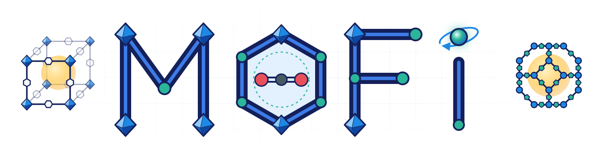
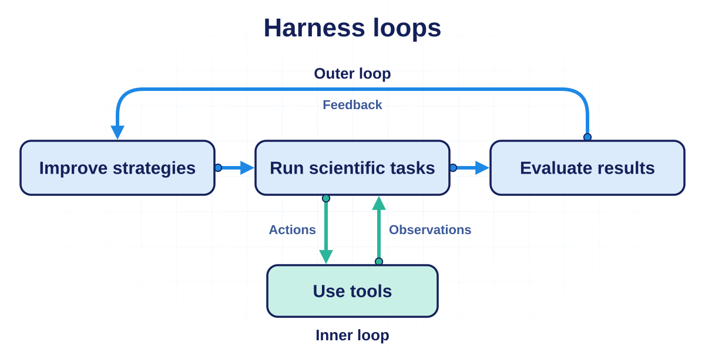
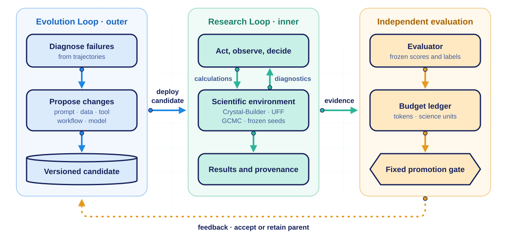

<h1 align="center">MOFi: An AI Harness for Autonomous Materials Research</h1>
<p align="center">
  <strong>M</strong>aterials <strong>O</strong>ptimization through <strong>F</strong>eedback-driven <strong>i</strong>ntelligence
</p>

<p align="center">
  <picture>
    <source media="(prefers-color-scheme: dark)" srcset="docs/images/mofi-logo-dark.svg">
    
  </picture>
</p>


**MOFi** is a research harness that connects AI agents, materials simulation tools, and feedback loops to study autonomous improvement.
It investigates physics-grounded agentic improvement loops as a proof of concept for **AI recursive self-improvement (RSI)**. We start from building an AI harness with the longer-term aim of autonomous materials research capabilities through scientific feedback.

**Motivation:** Can physics-informed models drive AI recursive self-improvement?

**Hackathon Target:** Build an AI harness for autonomous materials research and demonstrate agentic workflows driven by scientific feedback in metal–organic framework (MOF) research.
**Long-Term Target:** Systematically compare human-guided and autonomous AI-driven improvement of scientific models and workflows, measuring their improvement capabilities, effectiveness and efficiency under matched information and bounded compute.

**Team:** Qiankun Mo, Yi Cao, Xingfei Wei, and Junsung Lim.

<picture>
  <source media="(prefers-color-scheme: dark)" srcset="docs/images/harness-loops-dark.svg">
  
</picture>

**MOFi**: An **Outer (Evolution) Loop** proposes versioned improvements to models, tools, and workflows. An **Inner (Research) Loop** applies them in a reproducible scientific environment. An **independent evaluator** assesses the evidence against fixed criteria and tracks computational costs. Both loops use LLMs through supported API or CLI interfaces.

This repository contains functional components and user documentation. Development records and historical experiment outputs are maintained separately; see the [component and input boundaries](docs/COMPONENTS.md). Engineering validation and evidence of unseen-task generalization remain distinct.

### Research objective

Can an AI system autonomously improve its research procedures so that a successor solves **unseen scientific tasks more effectively under a fixed budget**? We begin with MOFs because structure construction, diagnostics, property prediction, simulation and scientific feedback can form an evaluable loop. Transfer to other materials is a research target, not an established result.

Here RSI initially means improving the versioned research system around a fixed LLM. It does not require continuous local LLM fine-tuning, and it does not yet establish that the outer improvement process improves itself.

### Human-guided versus autonomous improvement

We study three scientific model settings: ordinary GNNs, physics-informed approaches, and machine-learned interatomic potentials (MLIPs). They are experimental settings rather than mutually exclusive categories: MACE is itself a physics-aware GNN.

| Model setting | Existing foundation | Planned comparison |
|---|---|---|
| Ordinary GNN | G1/G2 periodic MOF property predictors; G3 encoder implementation | Frozen parent versus human-guided and autonomous recipe improvement |
| Physics-informed approach | GNN using the Jarzynski equality | Test explicitly defined physical constraints or estimators with matched controls |
| MLIP-GNN | ODAC23 energy/force and MACE feasibility evidence | Improve training recipes while preserving independent energy and force gates |

Current tracks use different targets and datasets; their raw accuracy scores cannot be pooled into a common model ranking. The planned human-versus-RSI comparison proposes a shared MOF energy/force task, operational model definitions and a three-model-setting by three-improver-condition matrix. A common task and its data admission must be established before that comparison runs; the synthetic FEAT task is not automatically equivalent to the proposed energy/force task.

Human and autonomous improvers should receive the same parent, development evidence, allowed modification space, proposal allowance and scientific compute budget. Record genuine human decisions separately from assistant-generated changes. Measure improvement relative to each parent, unseen-family performance, scientific validity and cumulative cost; report human effort and agent tokens separately. Add equal-budget random search or a non-inheriting agent control to distinguish recursive inheritance from ordinary search.

The existing Evolution/Research Loop harness provides execution, evidence, budgets and promotion controls for this program. Workflow and tool studies remain supporting experiments, alongside the five improvement axes below. Full multi-generation human/RSI comparisons and robust unseen-task gains remain research goals.

### System design

<picture>
  <source media="(prefers-color-scheme: dark)" srcset="docs/images/system-design-dark.svg">
  
</picture>

- **Evolution Loop:** diagnose failures; generate bounded changes; request unit tests and benchmarks; compare candidates; maintain versions and rollback. A fixed controller enforces budgets and promotion rules.
- **Research Loop:** construct MOFs, inspect structures, select calculations, respond to failures and analyze evidence. The screening path uses Crystal-Builder with bounded UFF calculations. A separate optional [methane GCMC adapter](docs/GCMC_METHANE.md) uses RASPA3; G1/G2 prediction experiments and the bounded MLIP evidence remain separate tracks. Other scientific engines are not all integrated into the screening loop.
- **Scientific environment:** preserve scientific semantics and provenance. Freeze engine versions, inputs, seeds, checkpoints and tolerances within a comparison. Random sampling and model training require statistical reproducibility; a fixed seed does not guarantee bitwise determinism.
- **Independent evaluation:** the evolving candidate cannot change the score, reference labels, cost accounting or acceptance threshold. Software correctness, scientific validity and research effectiveness are separate checks.

### Five axes of improvement

| Axis | Candidate changes | Experimental separation |
|---|---|---|
| Prompt | Instructions, evidence reporting and decision criteria | Fix tools, workflow and model |
| Data | Training/example selection, retrieval and feedback curation | Track provenance and prevent evaluation leakage |
| Tool | Reusable diagnostics, analysis and scientific tool composition | Distinguish outer-generated tools from inner-agent invention |
| Workflow | Candidate allocation, observation timing, conditional repair, stopping and budget reservation | Keep science, evaluator and per-task budget fixed |
| Model | GNN training recipes; optional [Qwen3-8B QLoRA candidates](docs/LLM_FINETUNING.md) | Treat GNN improvements and LLM weight updates as independent variables |

Start with single-axis experiments, then test combinations. Existing workflow and tool experiments are evaluated separately; the broader program now centers on human-guided versus autonomous improvement across the three scientific model settings.

### Core scientific questions

The overarching question is whether autonomous improvement can match or exceed human-guided improvement under equal opportunities, and whether physical constraints and scientific feedback change the gain, efficiency or generalization. The original component-level questions remain:

1. **Does joint Prompt + Tool + Workflow evolution outperform the best single-axis improvement?** Compare baseline, P, T, W, PT, PW, TW and PTW with matched evolution budgets; report execution costs separately. Distinguish combining independently evolved components from jointly evolving them. Use component removal and held-out tasks to test interactions.
2. **Do agent-written tools improve cross-task generalization?** Compare fixed tools, composition of fixed tools and new tool generation. Separately test outer-generated tools used by the Research Loop versus tools invented by the Research Loop itself. Count development/testing costs and evaluate frozen tools on new material families and task types.
3. **Does improvement saturate, and what limits it?** Track performance against generations and cumulative compute. From the same checkpoint, independently vary the outer model, inner model, tool capability, development feedback or search budget. Use repeated evolution chains; a short plateau or a saturated benchmark alone cannot identify a reasoning limit.
4. **Can evolving GNN training improve discovery sample efficiency?** First isolate training recipes on fixed labeled data, then study active learning under equal scientific-label budgets. Measure independently verified discoveries or labels needed to reach a target, alongside training cost. Prediction error alone is insufficient; a GNN cannot certify its own proposed discoveries.

### Experimental strategy and evidence standard

The planned model sequence is strong/strong for system validation, strong/Qwen3-8B for controlled main experiments, then crossed outer/inner model comparisons. The order is outer/inner. Qwen experiments and the full matrix remain planned. Fix the local checkpoint, quantization, thinking mode, context limit and call budget; record available API/CLI version evidence. Reproduce key findings with a strong model before claiming they generalize beyond an 8B model's weaknesses.

Freeze tasks, scientific targets, budgets and promotion criteria before each comparison. Separate public development, promotion validation and final held-out evaluation; repeated development gains are not unseen-task generalization. Report false discoveries, verified yield, time-to-evidence, model tokens/calls and scientific compute, including outer search costs and failed attempts. Unknown usage remains unknown. Archive rejected candidates and preserve both repository commits.

**Workflow benchmark target:** budget-constrained identification of MOF candidates with valid structure/preparation and actual finite calculation evidence. This benchmark does not establish adsorption optimization or physical stability.

### Layout

| Path | Contents|
|---|---|
| `rsi/` | Controllers, scientific adapters, evaluators|
| `configs/`, `workflows/`, `tools/` | Bounded settings and versioned candidates|
| `benchmarks/` | Tasks and compact reference fixtures|
| `tests/`, `scripts/` | Tests, audits, report generation|
| `docs/` | Architecture, interfaces and usage guides|
| `Crystal-Builder/` | Separate dependency checkout, not bundled|
| `runs/`, `artifacts/` | Ignored local raw logs and generated artifacts|

### Setup

Current process containment targets Windows. The workspace is a single [uv](https://docs.astral.sh/uv/) project on Python 3.12 (`pyproject.toml`, `uv.lock`) with a separate Crystal-Builder checkout installed editable. In PowerShell:

```powershell
git clone https://github.com/harrisonmo/MOFi.git
cd MOFi
git clone https://github.com/harrisonmo/Crystal-Builder.git Crystal-Builder
git -C Crystal-Builder checkout df014447f0812dd4f55ed60359b71a981c3eeb60
uv sync --frozen
$env:PYTHONUTF8 = "1"
$env:PYTEST_DISABLE_PLUGIN_AUTOLOAD = "1"
uv run --no-sync pytest tests/test_q2b_v21.py tests/test_q2b_recovery.py tests/test_q2b_http_transport.py -q --basetemp "$env:TEMP/mofi-pytest-readme"
```

This test subset makes no model calls. Other tests may execute scientific calculations or need historical local artifacts. Optional stacks (API SDKs, Valency, GUI, GNN/PyTorch, OpenMM, GCMC, LLM fine-tuning) are uv extras, e.g. `uv sync --extra api --extra gnn`; see [Python environment](docs/ENVIRONMENT.md). `uv.lock` pins the environment; historical manifests are maintained separately.

For model experiments, use your existing Codex CLI login; opt-in OpenAI, OpenAI-compatible and Claude API backends are described in [API backends](docs/API_BACKENDS.md). Read the relevant protocol, document a specific target and budget, pass calibration, and use a fresh output directory. Never silently resume a stopped ledger or count unknown usage as zero. Raw logs and historical absolute paths in summaries are not portable bundled assets; retrospective audits may need the original local `runs/` directories.

Start with [Architecture](docs/ARCHITECTURE.md), [Documentation index](docs/README.md), [Component and input boundaries](docs/COMPONENTS.md), and [Contributing](CONTRIBUTING.md).

Acknowledgement:
Metal–organic frameworks (MOFs) using [Crystal-Builder](https://github.com/harrisonmo/Crystal-Builder)

Original project code and documentation use **Apache License 2.0**; see [LICENSE](LICENSE). Crystal-Builder remains a separate MIT-licensed project. Dependencies and source materials retain their own terms; see [Third-party notices](THIRD_PARTY_NOTICES.md). GitHub visibility is initially private.

[Apache-2.0](LICENSE)
