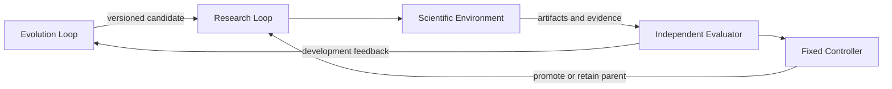

# Architecture

MOFi studies recursive self-improvement of a research system: successor
candidates should solve unseen scientific tasks more effectively under fixed
information and compute budgets. Materials research is the initial domain.

## Responsibilities

- The Evolution Loop proposes bounded prompt, data, tool, workflow or model
  recipe changes. It cannot change reference labels, scoring or cost accounting.
- The Research Loop chooses scientific actions, responds to diagnostics and
  reports evidence. It cannot directly promote a candidate or certify itself.
- The Scientific Environment fixes engines, structure semantics, input hashes,
  tolerances and seeds within each comparison. Crystal-Builder provides the
  construction foundation. ASE adapters connect actual calculators.
- The independent evaluator checks scientific validity and task performance.
  The fixed controller owns execution, cumulative budgets, promotion and rollback.

## Reproducibility and evaluation

A candidate binds parent, strategy, tools, workflow, model/data recipe,
environment, evaluator, budget and seed set. Run manifests record both repository
commits, input hashes, requested and observed backend/model identity, usage and
failures. Unknown usage is never counted as zero. Random seeds support statistical
reproducibility and do not promise bitwise equality.

Keep public development, promotion validation and final held-out evaluation
separate. Compare human-guided and autonomous changes using matched parents,
information, modification space, proposal allowance and scientific compute.
Account for outer search and failed attempts. A software test pass does not
establish scientific validity or unseen-task improvement.

The science hub validates bounded arguments, schedules jobs and returns evidence
envelopes. The agent uses that catalog through a structured backend contract;
the controller owns available tools and limits. Optional literature and ARIA
results are advisory, and do not replace independent scientific verification.
