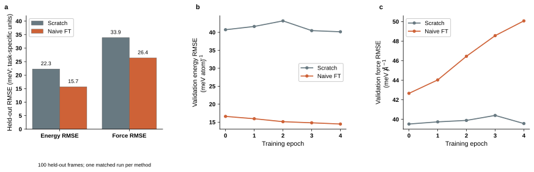
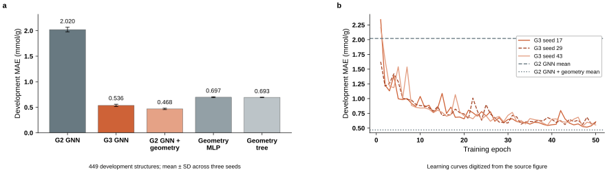

# MLIP and GNN result figures

Both figures use matching typography, slate/orange colors, open axes, and panel labels. The SVGs contain vector elements and editable text.

## MACE MLIP comparison

Panel a compares scratch training and naive foundation fine-tuning after one epoch on 100 deterministic held-out frames. Panels b and c show validation energy and force RMSE in a separate five-epoch comparison. Each method has one run; these figures describe bounded training comparisons.

This SVG preserves the original vector figure supplied with the archived [MACE evidence package](https://github.com/harrisonmo/LLM_Materials/blob/57f65c89e0e9286597529e24d0b2fd8d5e3a5ca4/docs/evidence/2026-10-22-rsi-mlip-interim-evidence/assets/figures/fig01_mace_s2ef_comparison.svg). Numerical content is unchanged.

## G3 methane working-capacity prediction

Panel a shows exact saved development MAE means and sample standard deviations across three seeds, from [G3_RESULT.json](https://github.com/harrisonmo/LLM_Materials/blob/57f65c89e0e9286597529e24d0b2fd8d5e3a5ca4/docs/reports/G3_RESULT.json). The target is methane working capacity at 298 K, defined as uptake at 65 bar minus uptake at 5.8 bar, in mmol/g. The development split contains 449 structures.

Panel b contains approximate learning curves digitized from the original [G3_COMPARISON.png](https://github.com/harrisonmo/LLM_Materials/blob/57f65c89e0e9286597529e24d0b2fd8d5e3a5ca4/docs/reports/G3_COMPARISON.png). The per-epoch history files referenced by the original plotting script were not committed on the checked branches. These curves reproduce the graphic and must not be treated as raw numerical measurements. The horizontal reference lines use exact saved means.

No scientific calculation or model training was rerun to make these figures. These model comparisons do not establish an effect of recursive agent improvement.
